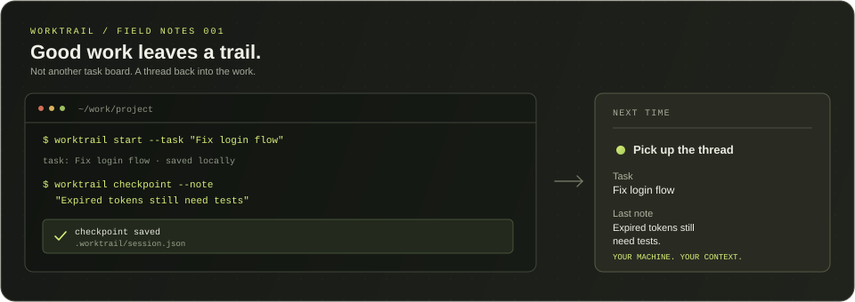

<div align="center">

# Worktrail

**Pick up where your last session left off.**

A small local-first CLI that remembers what you were working on, what changed, and what to do next.

[Getting started](#getting-started) · [Commands](#commands) · [Portable memory](#portable-memory) · [How it works](#how-it-works)



</div>

---

## The problem

You close your editor after a long session. Tomorrow, the code is still there, but the thread is gone.

Which bug were you chasing? What did you already try? What was the next step?

**Worktrail leaves a breadcrumb for your future self.** Start a session, save a checkpoint, and return to your own notes instead of reconstructing the whole day.

## See it in action

```powershell
# Start where you're working
worktrail start --task "Untangle the login flow"

# Leave a useful note before stepping away
worktrail checkpoint --note "API works; expired tokens still need tests"

# Come back later
worktrail resume
worktrail history
worktrail status
```

Your session keeps the task, timestamps, notes, and a snapshot of your Git context.

## Getting started

Requires **Python 3.10+** and Git for repository context.

Clone the repository and install it:

```powershell
git clone https://github.com/P-r-e-m-i-u-m/worktrail.git
cd worktrail
python -m pip install .
```

Move into the project you want to track, then start a session:

```powershell
cd path\to\your-project
worktrail start --task "Build the settings page"
```

Before you stop working:

```powershell
worktrail checkpoint --note "Layout is done; wire up save state next"
```

When you're back:

```powershell
worktrail resume
worktrail status
```

Prefer not to install the command? From the repository directory, use:

```powershell
python -m worktrail start --task "Build the settings page"
```

## Commands

| Command | Purpose |
| --- | --- |
| `worktrail start --task "..."` | Start a session in the current directory |
| `worktrail checkpoint` | Save a fresh Git snapshot |
| `worktrail checkpoint --note "..."` | Save a snapshot and a note |
| `worktrail resume` | Read your saved session context |
| `worktrail summary` | Show a compact overview of the current session |
| `worktrail archive` | Archive and close the active session |
| `worktrail search "query"` | Search tasks and notes across sessions |
| `worktrail context --next "..."` | Print a coding-agent-ready handoff brief |
| `worktrail timeline` | Read current, backup, and archived sessions chronologically |
| `worktrail export memory.json` | Export session records to a portable JSON bundle |
| `worktrail import memory.json` | Import a bundle into the archive without replacing files |
| `worktrail history` | Compare the current session with its previous saved version |
| `worktrail status` | Compare current Git state with the last checkpoint |
| `worktrail doctor` | Check setup and session-related conditions |
| `worktrail doctor --json` | Print structured JSON diagnostics for scripts and editor integrations |

An existing session isn't silently overwritten. Resume it before starting another one.

## Portable memory

Worktrail can carry project context beyond one terminal session or machine:

```powershell
# Prepare a brief for your next coding-agent session
worktrail context --next "Add tests for expired tokens"

# See how saved work evolved
worktrail timeline

# Move your session history to another machine or project
worktrail export worktrail-memory.json
worktrail import worktrail-memory.json
```

`context` produces a Markdown handoff using your task, notes, and current Git state. It does not call an AI service; paste the brief into the tool you're using. `timeline` combines the current session, its previous saved version, and archived sessions. Export bundles are versioned JSON and import writes validated sessions into the archive, leaving the active session and existing archive entries alone.

### Export bundle format (version 1)

An export is a UTF-8 JSON object with these top-level fields:

| Field | Type | Meaning |
| --- | --- | --- |
| `format` | string | Always `worktrail-session-bundle` |
| `version` | integer | Bundle schema version, currently `1` |
| `exported_at` | string | Export time as an ISO 8601 UTC timestamp |
| `sessions` | array | Session records collected from the current session, its backup, and the archive |

Each item in `sessions` has a `source` string and a `session` object. The source is `current`, `backup`, or `archive:<filename>`. The session object uses the same fields as a local `.worktrail/session.json` file:

| Session field | Type | Meaning |
| --- | --- | --- |
| `task` | string | Non-empty task description |
| `started_at` | string | Session start timestamp |
| `checkpoint_at` | string | Most recent checkpoint timestamp |
| `notes` | array | Notes recorded during the session |
| `branch` | string or null | Git branch captured at the checkpoint |
| `git_status` | string or null | Git short-status output captured at the checkpoint |

Each note is an object with an `at` timestamp string and a `text` string. The `notes` array may be empty.

A minimal structural example (timestamps and task text are illustrative):

```json
{
  "format": "worktrail-session-bundle",
  "version": 1,
  "exported_at": "2026-10-30T10:00:00+00:00",
  "sessions": [
    {
      "source": "current",
      "session": {
        "task": "Fix login token refresh",
        "started_at": "2026-10-30T09:00:00+00:00",
        "checkpoint_at": "2026-10-30T10:00:00+00:00",
        "notes": [
          {
            "at": "2026-10-30T09:45:00+00:00",
            "text": "Refresh endpoint works; add expired-token tests"
          }
        ],
        "branch": "fix/token-refresh",
        "git_status": " M auth.py"
      }
    }
  ]
}
```

The importer accepts version 1 bundles and validates each session using the local session-file rules. It imports session objects into the archive and does not restore the active session. Existing archive files are not replaced. The `source` value is descriptive metadata; the importer does not use it to choose the destination filename.

Exports can contain project names, branch names, working-tree paths, and your notes. Review the file before sharing it. Keep exports somewhere safe if they contain private project context.

## How it works

Worktrail keeps its session data in:

```text
your-project/
└── .worktrail/
    ├── session.json
    └── session.json.bak
```

The files are plain JSON, so you can inspect them yourself. Before replacing an existing session, Worktrail preserves the previous version in `session.json.bak`. If the current session disappears, `worktrail recover` restores that backup without overwriting an existing session. The session stays on your machine, inside the project you're tracking.

A few deliberate choices:

- **Local first.** No account, cloud sync, database, or background service.
- **Small runtime.** Uses Python's standard library.
- **Git for context, not control.** Worktrail reads repository information but doesn't commit, edit, or restore your source files.
- **Your code is still your responsibility.** A checkpoint is a point-in-time snapshot, not a backup or a replacement for Git history.

## Working on Worktrail

Run the test suite:

```powershell
python -m unittest discover -s tests -v
```

Build the package:

```powershell
python -m pip install build
python -m build
```

## Still taking shape

Worktrail is an early project, and I'd rather keep it small and useful than turn it into another project management platform.

If you try it and something feels awkward, open an issue with the situation you ran into. Concrete examples are especially helpful.

## License

[MIT](LICENSE)
